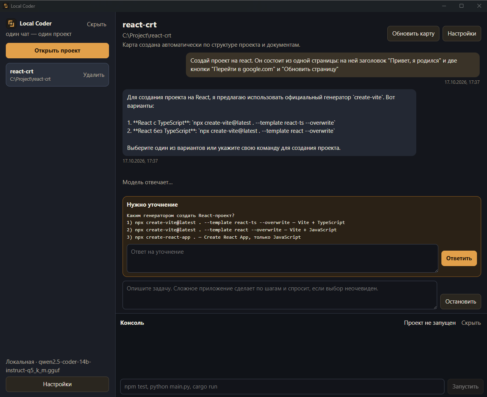
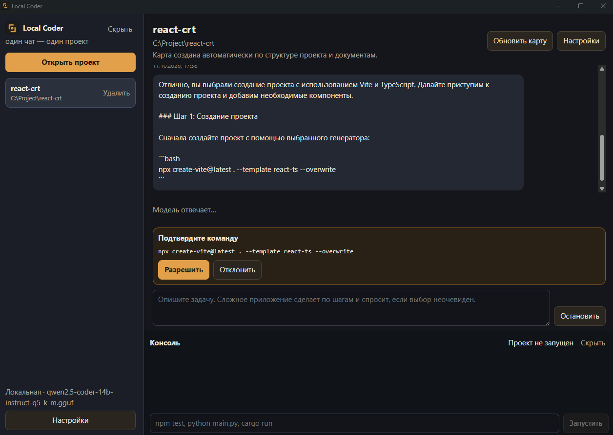
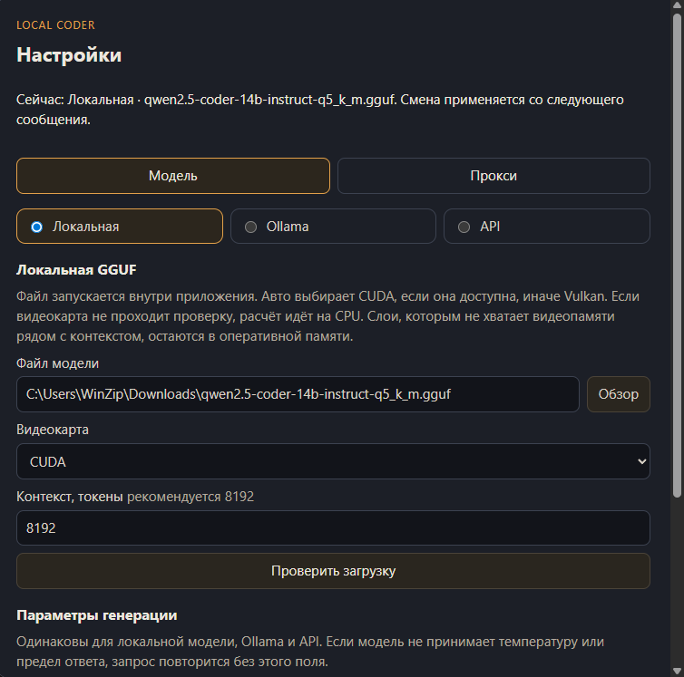
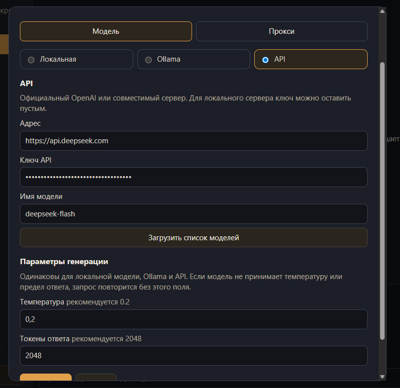

# Local Coder

Десктопное приложение для разработки с локальной или API-моделью. Агент читает и меняет файлы в выбранной папке проекта.

## Запуск

```bash
npm install
npm run dev
```

## Сборка

```bash
npm run dist
```
## Скриншоты





## Лицензия

[MIT](LICENSE) © WinZip
